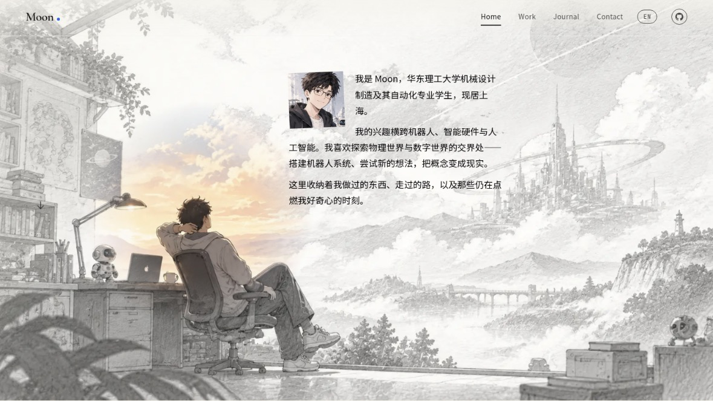

# MY SPACE

<em>A little world of my own.</em>
 
<strong>Still curious. Still exploring. Still becoming.</strong>

---

## Website

<a href="https://meng-p7.github.io/myspace/">
<strong>Explore My Space →</strong>
</a>

A personal space where I collect my experiences, projects, thoughts, and moments.

---

## About Me

### A curious mind, still becoming.

I've always been curious about the world around me.
I'm fascinated by how things work, how ideas take shape, and how something that once existed only in imagination can become real. From mechanical engineering and robotics to artificial intelligence and digital creation, I enjoy exploring the boundaries between technology, creativity, and everyday life.

But I don't think of myself as someone who has already figured everything out. I'm still learning, still experimenting, and sometimes still finding my way through uncertainty. I believe growing up isn't about becoming a perfectly defined person, but about staying curious, having the courage to try, and discovering a little more about yourself along the way.

This little corner of the internet is a collection of my experiences, projects, thoughts, and moments. It's not a finished story, nor an attempt to define who I am.
It's simply a place to capture who I am today, and who I'm becoming tomorrow.

**Still curious. Still exploring. Still becoming.**

---

## Credits

This project is made possible by the creativity and generosity of the open-source community.
Special thanks to:

- [Unfold](https://github.com/Dksie09/unfold) — for inspiration and implementation references for the 3D pop-up book experience.
- All the creators, developers, and open-source contributors whose work has helped shape this little space.
